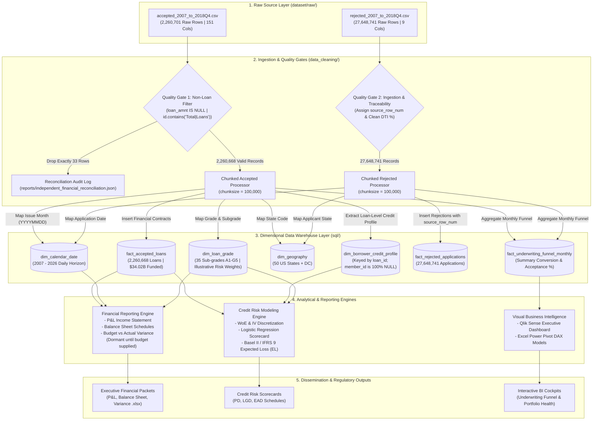

# End-to-End Data Lineage & Transformation Blueprint

**Project Name:** Financial Analytics and Risk Reporting System  
**Project ID:** DA-04  
**Classification:** Financial Data Lineage, Regulatory Traceability & Audit Trail  
**Compliance Standards:** BCBS 239 (Risk Data Aggregation) & IFRS 9 Auditability  
**Document Version:** 2.0 (Post-Audit Corrections)  

---

## 1. Overview & Regulatory Traceability

In institutional financial analytics and credit risk engineering, **Data Lineage** provides an immutable, transparent record of how every financial metric travels from raw source inputs through transformations, dimensional warehouse entities, and computational engines to final financial statements and credit risk scorecards.

Under regulatory frameworks such as **BCBS 239** and **IFRS 9**, data engineering pipelines must demonstrate that:
1. Every cash flow reported on the Profit & Loss statement reconciles back to underlying loan transaction logs.
2. Every credit risk probability of default (PD) is computed from clean, uncorrupted borrower credit bureau pulls.
3. No synthetic or invented data has been fabricated.
4. Source row numbers are maintained for datasets lacking natural business identifiers (such as the rejected inquiries file).

---

## 2. End-to-End Visual Data Lineage Flow



---

## 3. Field-Level Transformation & Lineage Mapping

### 3.1 Accepted Loans Source-to-Target Mapping (`accepted_2007_to_2018Q4.csv`)

| Raw CSV Source Field | Destination Table | Destination Column | Data Type | Transformation Logic & Lineage Rule |
| :--- | :--- | :--- | :---: | :--- |
| `id` | `fact_accepted_loans`<br>`dim_borrower_credit_profile` | `loan_id`<br>`loan_id` | `VARCHAR(32)` | Natural Lending Club loan identifier; trimmed of whitespace; primary key anchor. 100% unique across all 2,260,668 valid loans. |
| `member_id` | *(Excluded / Unmapped)* | — | — | **Empirically verified as 100.0% NULL**. Redacted by Lending Club for PII. Not used as primary or foreign key. |
| `issue_d` (e.g. `'Dec-2015'`) | `fact_accepted_loans` | `issue_date_key` | `INTEGER` | Converted from month string to ISO calendar key: `TO_DATE('Dec-2015', 'Mon-YYYY') -> 20151201`. Links to `dim_calendar_date.date_key`. |
| `grade`, `sub_grade` | `fact_accepted_loans` | `grade_key` | `INTEGER` | Mapped via surrogate key lookup against `dim_loan_grade` (`A1` -> 1, `B1` -> 6, ..., `G5` -> 35). |
| `addr_state` | `fact_accepted_loans` | `state_code` | `CHAR(2)` | Standardized to uppercase 2-letter state code. Links to `dim_geography.state_code`. |
| `loan_amnt`, `funded_amnt` | `fact_accepted_loans` | `loan_amnt`<br>`funded_amnt` | `NUMERIC(12,2)` | Direct numeric cast. Stated loan amount ($34,016,115,925.00 total) and funded commitment ($34,004,208,600.00 total). |
| `int_rate` | `fact_accepted_loans` | `int_rate` | `NUMERIC(6,4)` | Contractual yield rate percentage. Top-line P&L revenue driver. |
| `installment` | `fact_accepted_loans` | `installment` | `NUMERIC(10,2)` | Scheduled monthly repayment obligation ($). |
| `total_pymnt` | `fact_accepted_loans` | `total_pymnt` | `NUMERIC(14,2)` | Cumulative gross cash receipts realized ($27,314,649,582.62 total). |
| `total_rec_int` | `fact_accepted_loans` | `total_rec_int` | `NUMERIC(14,2)` | Gross interest income earned on P&L ($5,496,560,266.06 total). |
| `total_rec_late_fee` | `fact_accepted_loans` | `total_rec_late_fee`| `NUMERIC(10,2)` | Non-interest penalty fee revenue on P&L ($3,432,718.19 total). |
| `recoveries` | `fact_accepted_loans` | `recoveries` | `NUMERIC(12,2)` | Realized asset recoveries offsetting gross charge-offs ($325,262,956.86 total). |
| `loan_status` | `fact_accepted_loans` | `loan_status`<br>`is_confirmed_default`<br>`delinquency_tier`<br>`is_seasoned_closed` | `VARCHAR(50)`<br>`SMALLINT`<br>`VARCHAR(30)`<br>`SMALLINT` | **Classification Rule:**<br>- `'Fully Paid'` $\rightarrow$ `is_confirmed_default = 0`, `delinquency_tier = 'Closed Good'`, `closed = 1`<br>- `'Charged Off'`, `'Default'` $\rightarrow$ `is_confirmed_default = 1`, `delinquency_tier = 'Closed Default'`, `closed = 1`<br>- `'Current'` $\rightarrow$ `is_confirmed_default = NULL`, `delinquency_tier = 'Current'`, `closed = 0`<br>- `'Late (31-120 days)'` $\rightarrow$ `is_confirmed_default = NULL`, `delinquency_tier = 'Severe Late (31-120)'`, `closed = 0` (Kept distinct; NOT default). |
| `annual_inc` | `dim_borrower_credit_profile`| `annual_inc` | `NUMERIC(14,2)` | Borrower gross income. Missing values (5 records) preserved as `NULL`. |
| `dti` | `dim_borrower_credit_profile`| `dti` | `NUMERIC(7,2)` | Debt-to-income ratio (%). Missing values (1,712 records) preserved as `NULL`. |
| `fico_range_low`/`high` | `dim_borrower_credit_profile`| `fico_range_low`<br>`fico_range_high`<br>`fico_midpoint` | `INTEGER`<br>`INTEGER`<br>`INTEGER` | FICO bureau bounds. `fico_midpoint = (low + high) / 2`. |
| `emp_length` (e.g. `'10+ years'`) | `dim_borrower_credit_profile`| `emp_length`<br>`emp_length_years` | `VARCHAR(20)`<br>`SMALLINT` | Categorical string preserved; numeric years extracted: `'< 1 year' -> 0`, `'10+ years' -> 10`, `NULL -> NULL`. |

---

### 3.2 Rejected Applications Source-to-Target Mapping (`rejected_2007_to_2018Q4.csv`)

| Raw CSV Source Field | Destination Table | Destination Column | Data Type | Transformation Logic & Lineage Rule |
| :--- | :--- | :--- | :---: | :--- |
| Database Auto-Sequence | `fact_rejected_applications` | `rejection_surrogate_id` | `INTEGER` | Surrogate primary key generated during database ingestion. |
| **Physical CSV Row Index** | `fact_rejected_applications` | `source_row_num` | `INTEGER` | **1-indexed physical row number in `rejected_2007_to_2018Q4.csv`** (2 to 27,648,742). Ensures 100% exact backward traceability to raw data without implying an original Lending Club ID. |
| `Application Date` (e.g. `'2016-12-31'`) | `fact_rejected_applications` | `app_date_key`<br>`application_date` | `INTEGER`<br>`DATE` | Parsed to date key `20161231` (links to `dim_calendar_date.date_key`) and ISO date. |
| `Amount Requested` | `fact_rejected_applications` | `amount_requested` | `NUMERIC(12,2)` | Stated principal applied for ($). |
| `Risk_Score` | `fact_rejected_applications` | `risk_score` | `NUMERIC(6,1)` | Credit score proxy at rejection. Maintained as `NULL` when unretrieved (~66.90% null rate; genuine operational artifact). |
| `Debt-To-Income Ratio` (e.g. `'15.2%'`) | `fact_rejected_applications` | `dti_ratio` | `NUMERIC(7,2)` | Sanitized: stripped `'%'` character, cast to float. Unparseable values preserved as `NULL`. |
| `State` | `fact_rejected_applications` | `state_code` | `CHAR(2)` | Standardized 2-letter state code -> `dim_geography.state_code`. |
| `Employment Length` | `fact_rejected_applications` | `emp_length_raw` | `VARCHAR(20)` | Stated applicant employment tenure string. |
| `Loan Title` | `fact_rejected_applications` | `loan_title` | `VARCHAR(150)` | Stated loan purpose. |

---

## 4. Quality Gates & Reconciliation Controls

```
+-------------------------------------------------------------------------------------------------------------+
|                                  DATA WAREHOUSE QUALITY GATES & AUDIT CONTROLS                              |
+-------------------------------------------------------------------------------------------------------------+
| Gate 1: Non-Loan Row Filter     | Input: 2,260,701 raw rows                                                 |
|                                 | Assert: Exactly 33 rows dropped (32 quarterly footers + 1 section header)   |
|                                 | Output: 2,260,668 valid loan contracts (100% numeric IDs, positive loans)   |
+---------------------------------+---------------------------------------------------------------------------+
| Gate 2: Financial Integrity     | Assert: SUM(loan_amnt) in DB == $34,016,115,925.00                        |
|                                 | Assert: SUM(total_pymnt) in DB == $27,314,649,582.62                      |
|                                 | Variance Tolerance: $0.00 (Zero variance allowed)                         |
+---------------------------------+---------------------------------------------------------------------------+
| Gate 3: Referential Integrity   | Assert: Count of orphaned foreign keys == 0                               |
|                                 | Checks: issue_date_key in dim_calendar_date, grade_key in dim_loan_grade  |
|                                 | Profile Link: fact_accepted_loans.loan_id == dim_borrower_credit_profile   |
+---------------------------------+---------------------------------------------------------------------------+
| Gate 4: Zero Invented Data      | Rule: Never impute synthetic FICO, Income, or Yield into fact tables.     |
|                                 | Missing values preserved as native SQL NULL.                              |
|                                 | Budget metrics remain NULL until official targets are supplied.           |
+---------------------------------+---------------------------------------------------------------------------+
| Gate 5: Ingestion Idempotency   | Mechanism: ON CONFLICT DO NOTHING on loan_id and source_row_num.          |
|                                 | Checkpoint Tracking: etl_ingestion_checkpoints table tracks completed     |
|                                 | chunks, enabling seamless resume after failure with zero duplicates.       |
+-------------------------------------------------------------------------------------------------------------+
```

---

## 5. Development Sample Lineage & Schema Parity

The development sample (`dataset/raw/lending_club_loans.csv`) serves as a unit-testing benchmark for the ingestion pipeline:
* **Row Count:** Exactly 51,072 loan records.
* **Schema Parity:** 100% column parity (151 identical columns) with `accepted_2007_to_2018Q4.csv`.
* **Zero Footers:** 0 non-loan partition lines; 100% numeric loan IDs; 0 null `loan_amnt` values.
* **Financial Benchmarks:** Stated volume = **$767,112,825.00**; Total collections = **$767,235,505.08**.
* **Idempotent Ingestion Execution:** In sample mode (`--mode sample`), the pipeline ingests into the identical dimensional schema without altering table definitions or corrupting production state.

---

## 6. Audit Trail & Reproducibility Guarantee

1. **Immutable Raw Data:** Raw files in `dataset/raw/` (`accepted_2007_to_2018Q4.csv`, `rejected_2007_to_2018Q4.csv`, `lending_club_loans.csv`) are strictly read-only and never modified.
2. **Deterministic Processing:** All transformations are executed via version-controlled Python modules in `data_cleaning/`.
3. **Automated Verification:** The automated test suite in `tests/test_phase3_architecture.py` re-verifies primary key uniqueness, foreign key integrity, default classification, footer filtering, and `source_row_num` uniqueness.

