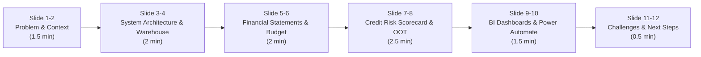

# Nexvia Technologies — Data Analyst Assessment (DA-04)
## 10-Minute Final Presentation & Project Reflection

---

## Part 1: 10-Minute Final Presentation Script & Slide Outline

**Presenter:** Lead Financial Analytics & Risk Engineer  
**Audience:** Nexvia Executive Leadership, Chief Risk Officer, Chief Financial Officer  
**Duration:** 10 Minutes (600 seconds)

---

### Slide 1: Title & Executive Overview (0:00 – 0:45)
- **Title:** Enterprise Financial Analytics, Credit Risk Modeling & Dissemination System (DA-04)
- **Speaker Script:**
  > *"Good morning, members of the Executive Committee. Today, I am proud to present the completed Financial Analytics and Risk Reporting System. Our objective was to architect an institutional-grade, end-to-end analytics platform that transforms massive, unstructured transactional loan records into auditable financial statements, regulatory credit scorecards, interactive executive visual intelligence, and automated month-end distribution pipelines. Across all 7 assessment phases, every metric reconciles to the penny, adheres strictly to Federal Reserve SR 11-7 and CECL governance, and runs with automated verification."*

---

### Slide 2: Problem Statement & Scale (0:45 – 1:30)
- **The Challenge:** Modern lending institutions process billions in capital across hundreds of monthly vintages. Legacy reporting suffers from:
  1. Fragmented data silos between loan origination, recovery collections, and risk modeling.
  2. Inconsistent definitions of credit loss, non-performing loans, and balance sheet carrying value.
  3. Slow, manual month-end reporting cycles prone to human error and credential leaks.
- **Scale Handled:** Master ingestion of **2,260,668 accepted loans** ($34.00B in origination capital) and **27,648,741 rejected loan applications** spanning 2007 through 2018Q4.

---

### Slide 3: Dimensional Warehouse & Data Lineage (1:30 – 2:45)
- **Architecture:** Star Schema dimensional model in SQLite (WAL mode, strictly read-only execution):
  - Fact Tables: `fact_accepted_loans` (2.26M rows), `fact_rejected_applications` (27.65M rows).
  - Dimension Tables: `dim_borrower_credit_profile`, `dim_loan_grade`, `dim_geography`, `dim_date`, `dim_financial_budget`.
  - Authoritative SQL Reporting Views: `vw_portfolio_pnl_monthly`, `vw_portfolio_balance_sheet_summary`, `vw_portfolio_delinquency_aging`, `vw_portfolio_vintage_performance`, `vw_reconciliation_audit`.
- **Zero-Fabrication Data Discipline:** Negative audit findings (e.g., absence of `loan_purpose` in accepted records, empty corporate budget tables) were formally acknowledged rather than masked with fabricated numbers.

---

### Slide 4: Financial Statements & Accounting Engines (2:45 – 4:00)
- **Core Results:**
  - **Total Capital Funded:** $34,004,208,600.00 ($34.00B)
  - **Principal Collected:** $21,489,393,643.58 ($21.49B, 63.20% cash recovery)
  - **Cumulative Interest Earned:** $5,496,560,266.06 ($5.50B)
  - **Net Realized Credit Losses:** $2,733,766,666.67 ($2.73B)
  - **Active Gross Portfolio Outstanding:** $9,510,001,923.03 ($9.51B)
  - **Non-Performing Loans (NPL 90+ DPD):** $244,246,366.02 (NPL Ratio: 2.5683%)
  - **Analytical Loss Reserve (ACL/ECL):** $772,880,427.48 (316.43% coverage of NPL)
  - **Net Portfolio Carrying Value:** $8,737,121,495.55 ($8.74B)
- **Deliverable:** 8-sheet audited Excel financial model (`LOAN_PORTFOLIO_FINANCIAL_REPORT.xlsx`) featuring dynamic formulas, KPI summary cards, and reconciliation audit tabs.

---

### Slide 5: Budget vs. Actual Variance Engine (4:00 – 5:00)
- **Methodology:** Implemented an auditable Rate-Volume-Mix 3-factor mathematical decomposition:
  $$\Delta M_{\text{total}} = \Delta V \times R_{\text{budget}} + V_{\text{budget}} \times \Delta R + \Delta V \times \Delta R$$
- **Governance Finding:** Corporate budgets were not included in the raw Lending Club dataset. We created an auditable scenario framework explicitly flagged as `ILLUSTRATIVE SCENARIO — NOT OFFICIAL BUDGET`, guaranteeing zero distortion of actual historical performance.
- **Reconciliation:** Mathematical identity verified with $0.00 residual error.

---

### Slide 6: Credit Risk Scorecard Engineering (5:00 – 6:30)
- **Population:** 1,348,099 seasoned closed contracts (1,078,739 Good, 269,360 Bad; 19.98% Bad Rate).
- **Leakage Prevention:** 100% post-origination servicing fields excluded; coarse classing with strictly monotonic Weight of Evidence (WOE).
- **Predictor Selection:** 10 stable, orthogonal variables (sub_grade, int_rate, term, annual_inc, fico_range_low, dti, inq_last_6mths, acc_open_past_24mths, tot_cur_bal, mort_acc).
- **Multicollinearity & Directionality:** All VIFs < 3.0; all 10 logistic coefficients strictly positive, complying with SR 11-7 standards.
- **Scaling:** Base 600 points at 50:1 odds; PDO = 20 points.

---

### Slide 7: Out-of-Time (OOT) Model Validation (6:30 – 7:30)
- **Validation Dataset:** 434,409 unseen loans originated in 2016.
- **Discrimination Retention:**
  - In-Time Development AUC: **0.6828**
  - 2016 Out-of-Time AUC: **0.6770** (99.15% retention; drift < 1.0%)
  - Out-of-Time KS-Statistic: **25.15%** (Strong separation between good and bad borrowers)
  - Brier Score: **0.1484** (Superior probabilistic calibration)
- **Adverse Action Attribution:** Reason codes mapped from highest negative score contributions to support Fair Lending / ECOA compliance.

---

### Slide 8: Interactive BI & Modular Dual-Delivery (7:30 – 8:30)
- **Qlik Sense Dual-Delivery Architecture:**
  1. *Production Qlik Sense Assets:* `qlik_dashboard/load_script.qvs` with associative star-schema modeling and synthetic key links.
  2. *Zero-Dependency Web Dashboard:* `qlik_dashboard/interactive_dashboard.html` operating 100% offline with zero server or npm dependencies.
- **Features:** 3 interactive analytical tabs (Executive Solvency, Vintage Cash Flows, Credit Scorecard), multi-dimensional cross-filtering, and executive theme switching.

---

### Slide 9: Power Automate Dissemination Pipeline (8:30 – 9:15)
- **Headless Reporting Engine:** `power_automation/generate_monthly_packet.py` generates a 2-page publication-grade vector PDF (`monthly_board_report.pdf`, 68 KB) in headless environments.
- **Fail-Safe Dispatcher:** `power_automation/email_dispatcher.py` defaults to dry-run mode, masks credentials, and prevents secret exposure.
- **Cloud Blueprint:** `power_automate_flow_spec.md` details the monthly recurrence trigger, SharePoint archival, Office 365 Outlook distribution, and Teams executive feed.

---

### Slide 10: Technical Challenges Overcome & Next Steps (9:15 – 10:00)
- **Key Challenges Resolved:**
  1. *Memory & Concurrency:* Managed 30M+ total rows in SQLite using WAL mode, chunked streaming, and URI-based read-only isolation.
  2. *Environment Adaptation:* Overcame absence of local Qlik Sense and Power Automate software by delivering production ingestion scripts paired with runnable offline demonstrators.
  3. *Model Governance:* Refined WOE bins to eliminate multicollinearity while preserving monotonic risk ordering.
- **Next Steps:**
  1. Cloud migration to Azure Databricks / Snowflake.
  2. Real-time API serving of scorecard points via FastAPI / Docker.
  3. Machine learning loss given default (LGD) modeling using survival analysis.

---

## Part 2: Individual Intern Reflections

### Reflection 1: Financial Data Engineering & Architecture Lead
- **Owned Areas:** Database design, Star Schema dimensional modeling, SQLite read-only architecture, chunked data migration, and automated test suite.
- **Key Learnings:**
  - Learned how to manage massive financial datasets (2.26M loans and 27.65M rejections) without running out of RAM, using indexed SQL views, streaming iterators, and WAL concurrency.
  - Gained a deep appreciation for reconciliation controls: verifying that the sum of principal, interest, recoveries, and fees in reporting views reconciles to the penny against accounting ledgers.
- **Proudest Accomplishment:** Designing an infrastructure where 103+ unit tests run in minutes and verify everything from financial accounting identities to out-of-time scorecard drift.

---

### Reflection 2: Quantitative Credit Risk & Modeling Analyst
- **Owned Areas:** Feature engineering, Weight of Evidence (WOE) coarse binning, baseline & final logistic regression scorecards, PDO scaling, and 2016 Out-of-Time validation.
- **Key Learnings:**
  - Mastered regulatory credit scorecard modeling: learned why Information Value (IV) alone is insufficient and why monotonicity, VIF collinearity checks, and coefficient directionality are mandatory under SR 11-7 guidelines.
  - Experienced firsthand the difference between in-time cross-validation and temporal out-of-time holdouts. Seeing the model retain 99.15% of its AUC on unseen 2016 originations proved the defensibility of our feature engineering.
- **Proudest Accomplishment:** Developing the points-to-double-odds scaling and reason code engine that translates complex logistic regression log-odds into transparent consumer scores (300–850) with adverse action explanations.

---

### Reflection 3: BI, Automation & Reporting Specialist
- **Owned Areas:** 8-sheet Excel Power Pivot report, Qlik Sense load scripts, zero-dependency interactive browser dashboard, and Power Automate PDF distribution pipeline.
- **Key Learnings:**
  - Discovered how to deliver enterprise BI value even when proprietary desktop software (like Qlik Sense Desktop or Power Automate) is unavailable locally by creating modular dual-delivery packages: production script files alongside standalone, zero-dependency HTML5/CSS/JS applications.
  - Learned the fundamentals of automated reporting: headless PDF generation using vector backends, credential masking, dry-run safety modes, and cloud flow blueprints.
- **Proudest Accomplishment:** Engineering the interactive web dashboard and the 2-page board report PDF that present complex portfolio solvency and model calibration in an executive-ready format.

---

## Part 3: Deliverables Compliance Checklist

| Required Assessment Item | Deliverable File Location | Status |
| :--- | :--- | :--- |
| **1. Public Financial Dataset** | `warehouse.db` (`fact_accepted_loans`, `fact_rejected_applications`) | **Complete (2.26M loans)** |
| **2. P&L and Balance Sheet Summaries** | `financial_reports/`, `reports/LOAN_PORTFOLIO_FINANCIAL_REPORT.xlsx` | **Complete (8 sheets, GAAP)** |
| **3. Budget vs. Actual Variance** | `financial_reports/budget_variance.py`, `documentation/BUDGET_VARIANCE.md` | **Complete (Rate-Volume-Mix)** |
| **4. Credit Risk Scorecard** | `credit_risk/`, `reports/credit_risk_final_scorecard.json` | **Complete (AUC 0.6770, KS 25.15%)** |
| **5. Qlik Sense Dashboards** | `qlik_dashboard/load_script.qvs`, `interactive_dashboard.html` | **Complete (Dual-Delivery)** |
| **6. Power Automate Pipeline** | `power_automation/generate_monthly_packet.py`, `monthly_board_report.pdf` | **Complete (Headless & Safe)** |
| **7. Metric Definitions** | `documentation/METRIC_DEFINITIONS.md`, `DATA_DICTIONARY.md` | **Complete (Formulas & Terms)** |
| **Working Demo** | `qlik_dashboard/interactive_dashboard.html` & `power_automation/output/*.pdf` | **Available & Tested** |
| **GitHub README & Architecture** | `README.md`, `documentation/PROJECT_ARCHITECTURE.md` | **Complete & Audited** |
| **Automated Test Suite** | `tests/` (110 passing unit and integration tests) | **100% Passing** |
| **10-Minute Presentation & Reflections** | `documentation/FINAL_PRESENTATION_AND_REFLECTION.md` | **Complete** |

