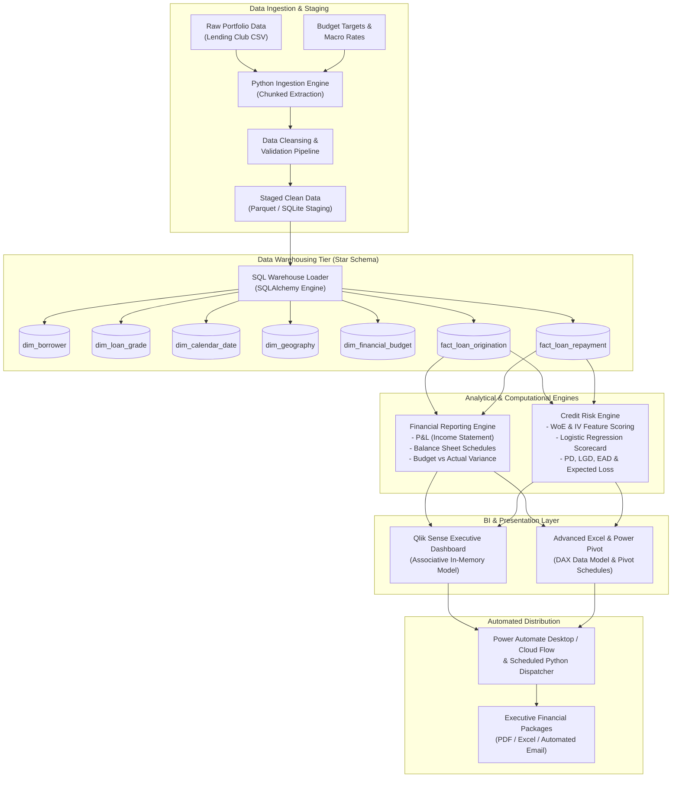
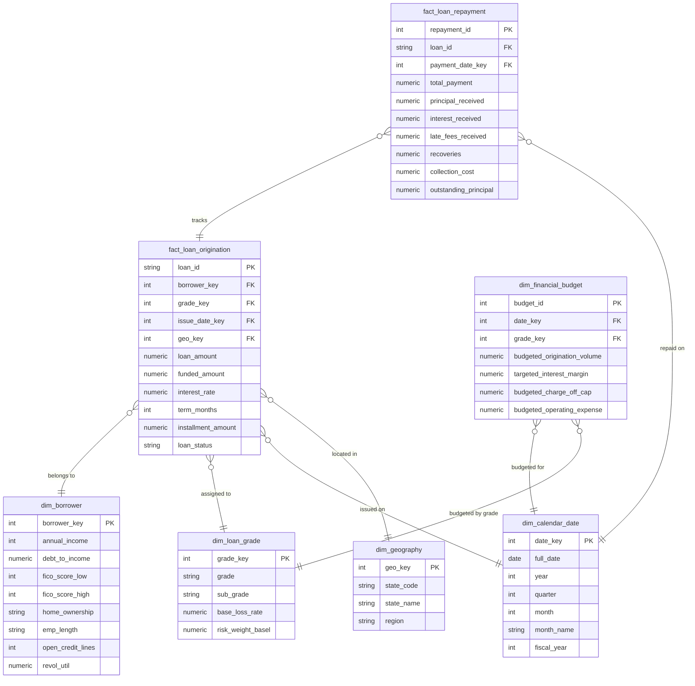

# System Architecture & Technical Design

**Project Name:** Financial Analytics and Risk Reporting System  
**Project ID:** DA-04  
**Classification:** Institutional Financial Data Architecture  
**Document Version:** 1.0  

---

## 1. Architectural Overview

The **Financial Analytics and Risk Reporting System** is structured as a multi-tier, decoupled data engineering and business intelligence architecture. It takes raw transactional loan and portfolio data, normalizes and cleanses it through an audited Python ETL pipeline, loads it into a high-performance dimensional data warehouse (Star Schema), and exposes data marts for financial statement synthesis, regulatory credit risk modeling, interactive BI dashboards, and robotic process automation.

---

## 2. End-to-End System Flow Diagram

---

## 3. Data Warehouse Schema (Dimensional Star Schema)

To support sub-second analytical queries, drill-downs across borrower demographics, and period-over-period financial aggregations, the data warehouse is modeled using Kimball dimensional modeling principles.

### 3.1 Entity Relationship Diagram (ERD)

---

## 4. Architectural Component Breakdown

### 4.1 Tier 1: Ingestion & Data Preparation (`data_cleaning/`)
- **Responsibility:** Ingest raw CSV data, perform deterministic type casting, validate data integrity, and engineer financial features.
- **Key Modules:**
  - `clean_pipeline.py`: Robust data sanitizer handling missing data imputation, date standardizations, and debt-to-income bounds checking.
  - `validation_rules.py`: Asserts domain logic (e.g., $Interest\ Rate > 0$, $Loan\ Amount \ge 1000$, $DTI \ge 0$).

### 4.2 Tier 2: Relational Data Warehousing (`sql/`)
- **Engine Options:** SQLite (portable, zero-configuration local warehouse) and PostgreSQL (enterprise multi-user option).
- **Key Assets:**
  - `schema.sql`: Full DDL script establishing primary keys, foreign key constraints, and performance indexes.
  - `financial_views.sql`: Materialized analytical SQL views synthesizing monthly cohort revenues, principal repayments, and delinquency buckets.

### 4.3 Tier 3: Financial Reporting Engine (`financial_reports/`)
- **P&L Engine (`p_and_l_engine.py`):**
  - Synthesizes top-line Interest Revenue from `fact_loan_repayment`.
  - Factors in Origination and Late Fee Income.
  - Deducts Cost of Funds (interest expense on borrowed operational capital).
  - Calculates Provision for Credit Losses (Cost of Risk) based on loan default stages.
  - Deducts Operating Expenses (servicing, overhead, underwriting).
  - Delivers Net Income and Net Interest Margin (NIM).
- **Balance Sheet Engine (`balance_sheet_engine.py`):**
  - Generates asset classification: Current Assets (Cash & short-term receivables) and Non-Current Assets (Gross Loan Portfolio).
  - Computes Contra-Asset: Allowance for Loan and Lease Losses (ALLL) under IFRS 9 ECL staging.
  - Classifies Liabilities: Notes payable and credit facilities.
  - Computes Equity & Retained Earnings, proving balance identity:
    $$\text{Assets} = \text{Liabilities} + \text{Equity}$$
- **Budget vs. Actual Variance Engine (`financial_reports/budget_variance.py`):**
  - **Governance Context:** In adherence to strict assessment integrity guidelines, official budget benchmarks are acknowledged as unsupplied in the Lending Club archive (`dim_financial_budget` has 0 rows). The engine operates under an explicitly labeled `ILLUSTRATIVE SCENARIO — NOT OFFICIAL BUDGET` framework.
  - **Dynamic Ingestion:** Queries actual financial cash flows dynamically from authoritative SQL reporting views (`vw_portfolio_pnl_monthly` and `vw_portfolio_vintage_performance`) with zero hard-coding.
  - **Variance Mechanics:** Computes absolute dollar variances and percentage variances, classifying performance as Favorable or Unfavorable based on financial directional logic (Revenue vs Cost items).
  - **Rate-Volume-Mix Decomposition:** Executes mathematical driver decomposition across volume ($\Delta V \cdot R_{\text{budget}}$), rate/pricing ($V_{\text{budget}} \cdot \Delta R$), and interaction mix ($\Delta V \cdot \Delta R$), proving exact mathematical reconciliation to total dollar variance.
  - **Outputs & Verification:** Emits `reports/budget_variance_analysis.json` and passes automated unit/integration validation in `tests/test_budget_variance.py`.

### 4.4 Tier 4: Credit Risk & Scorecard Engine (`credit_risk/`)
- **Mathematical Framework:** Basel II Internal Ratings-Based (IRB) approach and IFRS 9 Expected Credit Loss (ECL).
- **Key Modules:**
  - `woe_iv_transformer.py`: Discretizes continuous borrower features into monotonic bins and calculates Weight of Evidence (WoE) and Information Value (IV) for predictive power.
  - `scorecard_model.py`: Fits a regularized Logistic Regression classifier to predict Probability of Default (PD).
  - `score_scaling.py`: Translates log-odds into standard consumer credit scores (e.g., base score 600 at 50:1 odds, with 20 points doubling the odds).
  - `expected_loss.py`: Computes portfolio Expected Loss:
    $$EL = PD \times LGD \times EAD$$
    Where LGD is modeled using historical recovery rates and EAD is modeled using outstanding principal balances.

### 4.5 Tier 5: Presentation & Visual Intelligence (`qlik_dashboard/` & Excel)
- **Modular Dual-Delivery Architecture (Task 4):**
  - **Qlik Sense Enterprise Assets (`qlik_dashboard/load_script.qvs`):**
    - Production-grade Qlik Sense load script defining an associative in-memory model across 6 structured fact and dimension tables.
    - Employs synthetic keys (`%Key_Cohort`, `%Key_Grade`, `%Key_State`, `%Key_RiskTier`) linking P&L cash flows, vintage cohorts, credit risk bands, scorecard point allocations, and geographic summaries.
    - Fully documented in `qlik_dashboard/data_model_spec.md` with explicit governance disclosure that `loan_purpose` is unavailable in the accepted warehouse.
  - **Zero-Dependency Interactive Browser Dashboard (`qlik_dashboard/interactive_dashboard.html`):**
    - A standalone, enterprise-grade executive BI web dashboard operating 100% offline with zero server, npm, or paid library dependencies.
    - Features 3 comprehensive tabs:
      1. *Executive Portfolio & Solvency:* Headline KPIs ($34.00B Funded, $9.51B Active, 2.57% NPL, $772.88M Reserve, $8.74B Carrying Value), Annual Volume & WAC, Portfolio by Grade, Solvency Waterfall, and Regional Census Map.
      2. *Vintage Performance & Cash Flow:* $27.31B Cash Inflows, Monthly Cash Flow Trajectory (138 monthly cohorts), Vintage Default Rates, and Net Cash Margins.
      3. *Credit Risk Scorecard:* In-Time AUC (0.6828), In-Time KS (26.08%), Brier Score (0.1484), 2016 OOT AUC (0.6770), OOT KS (25.15%), 6-Band Risk Calibration, and Scorecard Feature Point Allocations.
    - Interactive cross-filtering across Year, Grade, Sub-Grade, Term, Region, and Risk Tier with dark/light executive theme toggling.
  - **Automated Data Extraction Pipeline (`qlik_dashboard/export_qlik_data.py`):**
    - Generates 6 lightweight, reconciled CSV extracts in `qlik_dashboard/data/` directly from SQLite views and Task 3 models.
  - **Validation & Test Automation (`tests/test_qlik_dashboard.py`):**
    - Validates schema, file existence, and asserts 100% exact numerical reconciliation against warehouse accounting totals.
- **Advanced Excel & Power Pivot Model:**
  - Embedded Data Model utilizing DAX measures for calculating dynamic financial ratios, period-over-period growth, and variance color-coded heatmaps.

### 4.6 Tier 6: Automation & Delivery (`power_automation/`)
- **Automated Monthly Board Report Pipeline (Task 5 / Step 6):**
  - **Headless PDF Generation Engine (`power_automation/generate_monthly_packet.py`):**
    - Directly queries authoritative SQL views (`vw_portfolio_pnl_monthly`, `vw_portfolio_balance_sheet_summary`) and Task 3 scorecard outputs (`reports/credit_risk_final_scorecard.json`).
    - Produces a publication-ready, two-page vector PDF executive packet (`power_automation/output/monthly_board_report.pdf`):
      - *Page 1:* Executive Overview, 6 KPI Headline Cards ($34.00B Funded, $9.51B Active Gross, $8.74B Net Carrying Value, $5.50B Interest Income, 2.5683% NPL Ratio, $772.88M Loss Reserve), Cumulative P&L Cash Flow Table, and Balance Sheet Solvency Waterfall.
      - *Page 2:* Credit Risk Scorecard Governance, Model Performance Cards (In-Time AUC 0.6828, 2016 OOT AUC 0.6770, OOT KS 25.15%), 10 Predictor WOE/IV & Model Coefficients Table, 2016 Out-of-Time Decile Calibration Table, and Model Risk Management (SR 11-7) Compliance Callout.
  - **Safe Email Dispatcher (`power_automation/email_dispatcher.py`):**
    - Enterprise email distribution engine supporting SMTP and Office 365 Exchange relays.
    - Default dry-run mode (`dry_run=True`) ensuring zero accidental external transmissions during test execution.
    - Strict credential masking (`mask_credential()`) preventing password or token leakage in logs or exceptions.
    - Fail-safe fallback producing structured operational status (`DRY RUN`, `READY TO SEND`, `CONFIGURATION ERROR`).
  - **Microsoft Power Automate Cloud Flow Specification (`power_automation/power_automate_flow_spec.md`):**
    - Production-ready cloud blueprint defining monthly recurrence trigger (1st of month at 06:00 UTC), Azure Automation/Desktop execution step, PDF validation condition, SharePoint document library archival, Office 365 Outlook email dispatch, and Microsoft Teams leadership feed notification.
    - Includes `run-after hasFailed` error handling scopes, P1 alerting, and explicit disclosure: `DESIGN/SPECIFICATION — LIVE CLOUD FLOW NOT EXECUTED IN THIS LOCAL ENVIRONMENT`.
  - **Automated Validation Suite (`tests/test_power_automation.py`):**
    - Unit and integration tests verifying PDF generation, metric precision, dry-run safety, credential masking, missing configuration handling, and flow spec completeness.
  - **Machine-Readable Validation Audit (`reports/task6_power_automation_validation.json`):**
    - Auditable verification artifact detailing PDF size, included KPIs, email dispatcher validation, and governance disclosures.

---

## 5. Security, Governance & Audit Trail

1. **Deterministic Reproducibility:** Every financial calculation is coded with traceable seed numbers and explicit SQL joins.
2. **Reconciliation Auditing:** Automated unit tests in `tests/` continuously reconcile total cash received against accounting ledger entries.
3. **Data Protection:** Personal Identifiable Information (PII) is masked or excluded at the ingestion layer, adhering to financial privacy standards.
