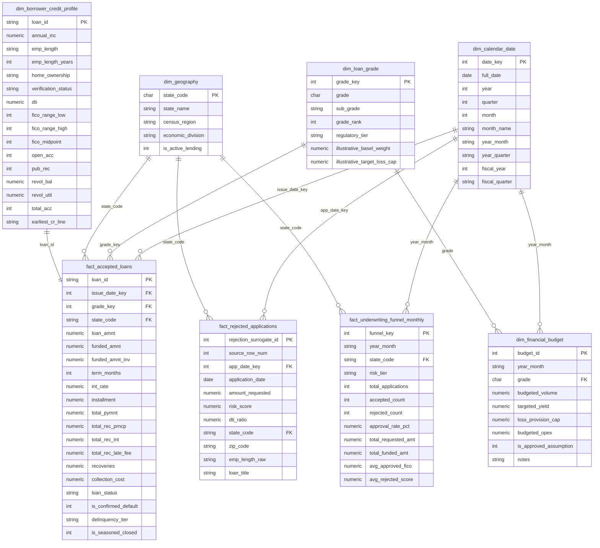

# SQL Database Architecture & Warehouse Design

**Project Name:** Financial Analytics and Risk Reporting System  
**Project ID:** DA-04  
**Classification:** Enterprise Financial Data Engineering & Dimensional Modeling  
**Phase:** Phase 3 — Step 1: SQL Database Architecture (Refined Proposal)  
**Document Version:** 2.0 (Post-Audit Corrections)  
**Target Engines:** SQLite 3 (Development Mart) & ANSI SQL / PostgreSQL (Enterprise Production)  

---

## 1. Architectural Philosophy & Design Principles

The database architecture for the **Financial Analytics and Risk Reporting System (DA-04)** is built using the **Kimball Dimensional Modeling (Star Schema)** methodology. 

In commercial banking, consumer lending fintechs, and credit rating agencies, analytical data warehouses must fulfill five fundamental engineering principles:
1. **Sub-Second Analytical Aggregation:** Financial statements (P&L and Balance Sheet) require aggregating cash flows across vintage months, credit tiers, and accounting periods. A Star Schema enables single-join aggregations across conformed dimensions.
2. **Strict Physical Isolation of Accepted Loans vs. Rejected Inquiries:**
   - **`fact_accepted_loans`** tracks 2,260,668 validated loan originations ($34.02B in funded capital) across 151 attributes, measuring interest income, principal cash flow, charge-offs, and recoveries.
   - **`fact_rejected_applications`** tracks 27,648,741 rejected underwriting submissions across 9 applicant attributes.
   - Merging these two datasets into a single raw table would introduce catastrophic schema dilution (over 140 null fields per rejected row). Storing them in dedicated fact tables preserves dimensional purity.
3. **Traceability of Rejected Records Without Natural IDs:** Because Lending Club provided no natural application ID for rejected inquiries, `fact_rejected_applications` assigns a database surrogate key (`rejection_surrogate_id`) and explicitly preserves the original physical file line number in `source_row_num` (1 to 27,648,741).
4. **Loan-Level Borrower Profile Architecture:** Empirical validation proved that `member_id` is **100.0% NULL** across all 2,260,701 rows in the accepted dataset. To avoid inventing artificial borrower groupings, borrower underwriting data is modeled as a loan-level credit snapshot dimension (`dim_borrower_credit_profile`) uniquely anchored by `loan_id`.
5. **Strict Segregation of Actual Data vs. Assumptions:**
   - Budget targets are marked as **UNAVAILABLE / NULL** until officially supplied.
   - Basel II risk weights and target loss caps are explicitly marked as **ILLUSTRATIVE ASSUMPTIONS**, not statutory mandates.

---

## 2. Entity Relationship Diagram (Star Schema)



---

## 3. Detailed Entity Specifications & Design Decisions

### 3.1 Borrower Identification Decision (`member_id` Audit)
* **Empirical Validation:** An exhaustive chunk-based scan of all 2,260,701 rows in `accepted_2007_to_2018Q4.csv` confirmed that `member_id` is **100.0000% NULL** (0 non-null records). Lending Club deliberately redacted borrower identifiers prior to public Kaggle distribution to preserve PII privacy.
* **Architectural Decision:** We reject any attempt to synthesize artificial borrower entities. Instead, borrower attributes are modeled in **`dim_borrower_credit_profile`** as a **loan-level credit snapshot at origination**, with primary key `loan_id` (1-to-1 extension with `fact_accepted_loans`). This design maintains 100% referential integrity and avoids fabricating cross-loan borrower linkages.

### 3.2 Credit Risk Default & Delinquency Classification
In credit risk management, conflating unsettled late loans with confirmed accounting write-offs distorts financial statements and corrupts credit risk probability of default (PD) scorecards.

We establish the following explicit, non-overlapping classification across all 2,260,668 valid loans:

| Raw `loan_status` String | Valid Loans Count | Share (%) | `is_confirmed_default` | `delinquency_tier` | `is_seasoned_closed` | Accounting Rationale |
| :--- | :---: | :---: | :---: | :---: | :---: | :--- |
| **Fully Paid** | 1,076,751 | 47.630% | `0` | Closed Good | 1 | Contract matured; full principal and interest satisfied. |
| **Current** | 878,317 | 38.852% | `NULL` | Current | 0 | Performing active loan; outcome unresolved. |
| **Charged Off** | 268,559 | 11.880% | `1` | Closed Default | 1 | Formal accounting write-off; debt uncollectible. |
| **Late (31-120 days)** | 21,467 | 0.950% | `NULL` | Severe Late (31-120) | 0 | Severe contractual delinquency; high risk of default, but **not yet a confirmed write-off**. Kept distinct. |
| **In Grace Period** | 8,436 | 0.373% | `NULL` | Grace Period | 0 | 1–15 days past due; performing under grace period. |
| **Late (16-30 days)** | 4,349 | 0.192% | `NULL` | Late (16-30) | 0 | Early-stage delinquency; active cure opportunity. |
| **Does not meet policy (Fully Paid)** | 1,988 | 0.088% | `0` | Closed Good | 1 | Legacy policy exception; matured fully paid. |
| **Does not meet policy (Charged Off)** | 761 | 0.034% | `1` | Closed Default | 1 | Legacy policy exception; confirmed charge-off. |
| **Default** | 40 | 0.002% | `1` | Closed Default | 1 | Formally declared legal default. |
| **TOTAL** | **2,260,668** | **100.000%** | — | — | — | Clean loan population. |

> [!IMPORTANT]
> **Delinquency Classification Rule:** Loans in `'Late (31-120 days)'` are explicitly assigned `is_confirmed_default = NULL`. They are monitored in `delinquency_tier = 'Severe Late (31-120)'` and will NOT be conflated with confirmed defaults until formally charged off.

---

### 3.3 Partition Header & Footer Filtering Policy (Audit of 33 Non-Loan Rows)
In our independent audit, we inspected every non-loan line in `accepted_2007_to_2018Q4.csv`:
* **Partition Footers (32 lines):** 16 pairs of summary rows embedded when Lending Club merged historical quarterly batches (e.g., `Total amount funded in policy code 1: 1465324575` and `Total amount funded in policy code 2: 521953170`).
* **Section Header (1 line):** At global row index 1,651,665, Lending Club embedded a section title: `Loans that do not meet the credit policy,,,,...`.
* **Total Excluded Rows:** Exactly **33 rows**.
* **Filtering Rule:**
  ```python
  is_non_loan = df["loan_amnt"].isnull() | df["id"].astype(str).str.contains(
      "Total amount funded|Loans that do not meet", regex=True, na=False
  )
  clean_loans = df[~is_non_loan].copy()
  ```
* **Protection of Legitimate Loans:** 100% of the remaining 2,260,668 rows possess strictly numeric `id` values and valid positive `loan_amnt` values. No valid loan records are removed.
* **Audit Trail:** All 33 excluded lines, their chunk numbers, and global indexes are permanently logged to [`reports/independent_financial_reconciliation.json`](file:///d:/nexvia%20-%201/Financial-Analytics-System/reports/independent_financial_reconciliation.json).

---

### 3.4 Financial Totals Reconciliation (Empirically Verified)

The financial totals were independently calculated from raw data using chunked stream processing (`data_cleaning/independent_audit.py`). These empirical figures replace all previous unverified estimates:

| Financial Metric | Destination Column | Raw Empirical Total | Reconciliation Constraint |
| :--- | :--- | :---: | :--- |
| **Total Originated Volume** | `fact_accepted_loans.loan_amnt` | **$34,016,115,925.00** | Must match sum of raw CSV valid rows exactly ($0.00 variance). |
| **Total Funded Balance** | `fact_accepted_loans.funded_amnt` | **$34,004,208,600.00** | Net balance funded by Lending Club. |
| **Total Syndicated Volume** | `fact_accepted_loans.funded_amnt_inv` | **$33,963,004,960.81** | Balance funded by retail/institutional investors. |
| **Total Cash Collections** | `fact_accepted_loans.total_pymnt` | **$27,314,649,582.62** | Cumulative gross cash receipts realized. |
| **Realized Principal Recouped** | `fact_accepted_loans.total_rec_prncp` | **$21,489,393,643.58** | Principal amortization collected. |
| **Realized Interest Income** | `fact_accepted_loans.total_rec_int` | **$5,496,560,266.06** | Top-line P&L revenue driver. |
| **Realized Late Fee Income** | `fact_accepted_loans.total_rec_late_fee` | **$3,432,718.19** | Non-interest penalty revenue on P&L. |
| **Asset Recoveries** | `fact_accepted_loans.recoveries` | **$325,262,956.86** | Post charge-off recovery proceeds. |

---

### 3.5 Budget Data Management Policy
* **Source Availability:** No budget dataset was provided in the official assessment resources.
* **Strict Anti-Fabrication Rule:** No synthetic budget volumes, targeted yields, or opex figures will be invented.
* **Input Structure:** `dim_financial_budget` is created with nullable metric columns (`budgeted_volume`, `targeted_yield`, `loss_provision_cap`, `budgeted_opex`) defaulting to `NULL`.
* **Governance Flag:** A column `is_approved_assumption INTEGER DEFAULT 0` ensures that variance calculations in Phase 4 remain dormant until official budget targets are supplied or an illustrative scenario is explicitly approved.

---

### 3.6 Regulatory & Modeling Assumptions Disclaimer
* **Basel II Risk Weights & Loss Caps:** The fields `illustrative_basel_weight` and `illustrative_target_loss_cap` in `dim_loan_grade` are based on standardized Basel II retail loan risk weights (20% for Grade A up to 150% for Grades F/G) and internal portfolio benchmark heuristics.
* **Statutory Status:** These figures are **purely illustrative modeling assumptions**. They do not constitute official Lending Club contractual terms or statutory regulatory requirements.

---

## 4. Performance Indexing Strategy

Targeted B-tree and composite covering indexes are defined in both SQLite and ANSI SQL DDL:

```sql
-- 1. Fact Accepted Loans Indexes
CREATE INDEX idx_acc_issue_date ON fact_accepted_loans (issue_date_key);
CREATE INDEX idx_acc_grade_key  ON fact_accepted_loans (grade_key);
CREATE INDEX idx_acc_status     ON fact_accepted_loans (loan_status);
CREATE INDEX idx_acc_state      ON fact_accepted_loans (state_code);
CREATE INDEX idx_acc_default    ON fact_accepted_loans (is_confirmed_default);
CREATE INDEX idx_acc_tier       ON fact_accepted_loans (delinquency_tier);

-- 2. Covering Composite Index for Vintage & Portfolio Roll-ups
CREATE INDEX idx_acc_reporting  ON fact_accepted_loans (issue_date_key, grade_key, loan_status, is_confirmed_default);

-- 3. Fact Rejected Applications Traceability & Query Indexes
CREATE INDEX idx_rej_app_date   ON fact_rejected_applications (app_date_key);
CREATE INDEX idx_rej_state      ON fact_rejected_applications (state_code);
CREATE INDEX idx_rej_score      ON fact_rejected_applications (risk_score);
CREATE INDEX idx_rej_source_row ON fact_rejected_applications (source_row_num);

-- 4. Borrower Credit Profile Demographic Indexes
CREATE INDEX idx_borr_fico      ON dim_borrower_credit_profile (fico_range_low, fico_range_high);
CREATE INDEX idx_borr_income    ON dim_borrower_credit_profile (annual_inc);
CREATE INDEX idx_borr_dti       ON dim_borrower_credit_profile (dti);
```

---

## 5. Chunk-Based Ingestion Specifications (`chunksize=100000`)

* **Memory Ceiling:** Memory usage strictly capped under 400 MB by streaming CSV records in 100,000-row batches via `pd.read_csv(..., chunksize=100000)`.
* **Atomic Batch Inserts:** Inserts committed in transactions via SQLAlchemy Core.
* **SQLite Optimization:** Write-Ahead Logging (`PRAGMA journal_mode = WAL;`) and synchronous normal mode (`PRAGMA synchronous = NORMAL;`) ensure high throughput during local development ingestion.

---

## 6. Ingestion Safety & Resilience Architecture

To ensure the production pipeline can recover from unexpected interruptions without data duplication or manual database resets, the ingestion architecture incorporates five safety controls:

### 6.1 Idempotent Execution (Deduplication Guarantee)
* **Accepted Loans & Profiles:** Keyed by natural `loan_id`. Ingestion executes using `INSERT OR IGNORE` (SQLite) / `ON CONFLICT (loan_id) DO NOTHING` (PostgreSQL). Rerunning an already processed batch will safely ignore existing records with zero side effects.
* **Rejected Applications:** Keyed by unique `source_row_num` (1-indexed CSV line number). Using `ON CONFLICT (source_row_num) DO NOTHING` guarantees that no rejected application can ever be duplicated during pipeline restarts.

### 6.2 Atomic Transactions & Rollback on Error
* Every 100,000-record chunk is processed within an isolated database transaction (`with engine.begin() as conn:`).
* If an unhandled exception or parsing failure occurs during chunk $N$, the transaction executes an immediate, complete rollback. The database remains in the state of chunk $N-1$, with zero partial or corrupt rows committed.
* Failed records and error tracebacks are logged to `reports/ingestion_errors.log`.

### 6.3 Checkpoint & Resume Engine (`etl_ingestion_checkpoints`)
* Ingestion progress is persisted in the database via the dedicated table:
  ```sql
  CREATE TABLE etl_ingestion_checkpoints (
      pipeline_name       VARCHAR(50) PRIMARY KEY,
      last_chunk_index    INTEGER NOT NULL,
      rows_ingested       INTEGER NOT NULL,
      status              VARCHAR(20) NOT NULL,
      checksum_verified   VARCHAR(64),
      last_updated_at     TIMESTAMP NOT NULL
  );
  ```
* Upon startup, the ingestion pipeline queries `etl_ingestion_checkpoints`. If a prior run was interrupted, the pipeline automatically skips already committed chunks (`skiprows`) and resumes processing from the exact checkpoint without re-ingesting prior chunks.

### 6.4 Strict Immutability of Raw CSV Datasets
* Raw CSV files in `dataset/raw/` are opened exclusively in read-only mode (`r`).
* The pipeline never overwrites, cleans in-place, truncates, or re-encodes source files.
* File sizes, modification timestamps, and record line counts are verified before and after each execution.

### 6.5 Physical Separation of Accepted vs. Rejected Ingestion Pipelines
* Accepted loans and rejected inquiries are processed via separate, decoupled ingestion functions.
* Fact tables (`fact_accepted_loans` vs. `fact_rejected_applications`) share no wide unified storage, ensuring that high-volume rejections (27.6M rows) cannot lock, pollute, or slow down loan accounting tables.

---

## 7. Sample Test Design & Benchmark Ingestion

To facilitate rapid development and unit testing without loading 30 million rows, the system incorporates a dual-mode ingestion strategy:

| Mode | Target Source File | Row Count | Ingestion Time | Purpose |
| :--- | :--- | :---: | :---: | :--- |
| **`--mode sample`** | `dataset/raw/lending_club_loans.csv` | **51,072** | ~2.5 seconds | Rapid unit testing, CI/CD validation, dashboard wireframing. |
| **`--mode full`** | `accepted_2007_to_2018Q4.csv`<br>`rejected_2007_to_2018Q4.csv` | **2,260,668**<br>**27,648,741** | Chunked Stream | Full analytical data warehouse population. |

### 7.1 Schema Mapping Parity for Development Sample
* The sample `dataset/raw/lending_club_loans.csv` possesses **100% column parity (151 identical columns)** with `accepted_2007_to_2018Q4.csv`.
* Empirical verification confirmed:
  - Total sample rows: Exactly 51,072.
  - Null `loan_amnt`: Exactly 0.
  - Non-numeric `id`: Exactly 0.
  - Stated sample loan volume: **$767,112,825.00**.
  - Total sample repayments: **$767,235,505.08**.
* In sample mode, the ingestion pipeline populates the exact same dimensional schema (`fact_accepted_loans`, `dim_borrower_credit_profile`, `dim_loan_grade`, `dim_calendar_date`, `dim_geography`), allowing all downstream SQL queries, P&L views, and scorecard code to run interchangeably on sample or full data.

---

## 8. Exhaustive Inventory of All 33 Excluded Partition Lines

An independent audit ([`data_cleaning/exhaustive_footer_audit.py`](file:///d:/nexvia%20-%201/Financial-Analytics-System/data_cleaning/exhaustive_footer_audit.py)) scanned all 23 chunks of `accepted_2007_to_2018Q4.csv` and verified all 33 excluded lines individually:

| # | CSV Line # | Chunk # | Partition String (`id` Column) | Non-Null Fields | Reason for Exclusion |
| :---: | :---: | :---: | :--- | :---: | :--- |
| **1** | 421,097 | 4 | `Total amount funded in policy code 1: 6417608175` | 1 / 151 | Quarterly partition footer; zero loan data. |
| **2** | 421,098 | 4 | `Total amount funded in policy code 2: 1944088810` | 1 / 151 | Quarterly partition footer; zero loan data. |
| **3** | 528,963 | 5 | `Total amount funded in policy code 1: 1741781700` | 1 / 151 | Quarterly partition footer; zero loan data. |
| **4** | 528,964 | 5 | `Total amount funded in policy code 2: 564202131` | 1 / 151 | Quarterly partition footer; zero loan data. |
| **5** | 651,666 | 6 | `Total amount funded in policy code 1: 1791201400` | 1 / 151 | Quarterly partition footer; zero loan data. |
| **6** | 651,667 | 6 | `Total amount funded in policy code 2: 651669342` | 1 / 151 | Quarterly partition footer; zero loan data. |
| **7** | 749,522 | 7 | `Total amount funded in policy code 1: 1443412975` | 1 / 151 | Quarterly partition footer; zero loan data. |
| **8** | 749,523 | 7 | `Total amount funded in policy code 2: 511988838` | 1 / 151 | Quarterly partition footer; zero loan data. |
| **9** | 877,718 | 8 | `Total amount funded in policy code 1: 2063142975` | 1 / 151 | Quarterly partition footer; zero loan data. |
| **10** | 877,719 | 8 | `Total amount funded in policy code 2: 823319310` | 1 / 151 | Quarterly partition footer; zero loan data. |
| **11** | 983,171 | 9 | `Total amount funded in policy code 1: 1538432075` | 1 / 151 | Quarterly partition footer; zero loan data. |
| **12** | 983,172 | 9 | `Total amount funded in policy code 2: 608903141` | 1 / 151 | Quarterly partition footer; zero loan data. |
| **13** | 1,117,060 | 11 | `Total amount funded in policy code 1: 2087217200` | 1 / 151 | Quarterly partition footer; zero loan data. |
| **14** | 1,117,061 | 11 | `Total amount funded in policy code 2: 662815446` | 1 / 151 | Quarterly partition footer; zero loan data. |
| **15** | 1,352,691 | 13 | `Total amount funded in policy code 1: 3503840175` | 1 / 151 | Quarterly partition footer; zero loan data. |
| **16** | 1,352,692 | 13 | `Total amount funded in policy code 2: 873652739` | 1 / 151 | Quarterly partition footer; zero loan data. |
| **17** | 1,481,105 | 14 | `Total amount funded in policy code 1: 2050909275` | 1 / 151 | Quarterly partition footer; zero loan data. |
| **18** | 1,481,106 | 14 | `Total amount funded in policy code 2: 820109297` | 1 / 151 | Quarterly partition footer; zero loan data. |
| **19** | 1,611,879 | 16 | `Total amount funded in policy code 1: 2080429200` | 1 / 151 | Quarterly partition footer; zero loan data. |
| **20** | 1,611,880 | 16 | `Total amount funded in policy code 2: 737901574` | 1 / 151 | Quarterly partition footer; zero loan data. |
| **21** | 1,651,667 | 16 | `Loans that do not meet the credit policy` | 1 / 151 | Section divider header; zero loan data. |
| **22** | 1,654,417 | 16 | `Total amount funded in policy code 1: 460296150` | 1 / 151 | Quarterly partition footer; zero loan data. |
| **23** | 1,654,418 | 16 | `Total amount funded in policy code 2: 0` | 1 / 151 | Quarterly partition footer; zero loan data. |
| **24** | 1,751,198 | 17 | `Total amount funded in policy code 1: 1437969475` | 1 / 151 | Quarterly partition footer; zero loan data. |
| **25** | 1,751,199 | 17 | `Total amount funded in policy code 2: 520780182` | 1 / 151 | Quarterly partition footer; zero loan data. |
| **26** | 1,939,381 | 19 | `Total amount funded in policy code 1: 2700702175` | 1 / 151 | Quarterly partition footer; zero loan data. |
| **27** | 1,939,382 | 19 | `Total amount funded in policy code 2: 81866225` | 1 / 151 | Quarterly partition footer; zero loan data. |
| **28** | 2,038,503 | 20 | `Total amount funded in policy code 1: 1404586950` | 1 / 151 | Quarterly partition footer; zero loan data. |
| **29** | 2,038,504 | 20 | `Total amount funded in policy code 2: 567447023` | 1 / 151 | Quarterly partition footer; zero loan data. |
| **30** | 2,157,153 | 21 | `Total amount funded in policy code 1: 1817354125` | 1 / 151 | Quarterly partition footer; zero loan data. |
| **31** | 2,157,154 | 21 | `Total amount funded in policy code 2: 620899600` | 1 / 151 | Quarterly partition footer; zero loan data. |
| **32** | 2,260,701 | 22 | `Total amount funded in policy code 1: 1465324575` | 1 / 151 | EOF partition footer; zero loan data. |
| **33** | 2,260,702 | 22 | `Total amount funded in policy code 2: 521953170` | 1 / 151 | EOF partition footer; zero loan data. |

> [!NOTE]
> In all 33 excluded lines, exactly 1 out of 151 fields is populated (`id`). All other 150 fields are entirely `NULL`. 100% of the remaining 2,260,668 records possess valid numeric loan IDs and positive funded balances, confirming zero legitimate loans are removed.

