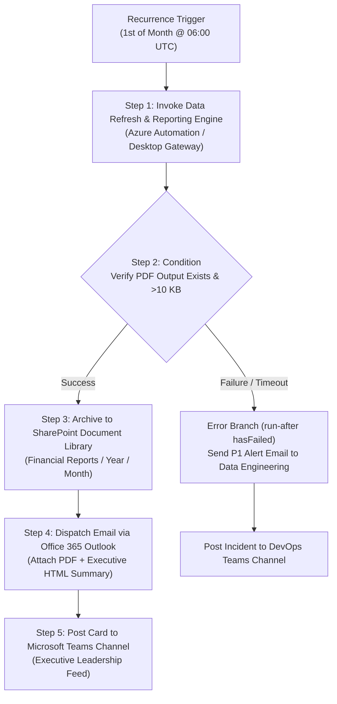

# Microsoft Power Automate — Monthly Board Report & PDF Automation Flow Specification

> [!IMPORTANT]
> **GOVERNANCE STATUS: DESIGN/SPECIFICATION — LIVE CLOUD FLOW NOT EXECUTED IN THIS LOCAL ENVIRONMENT**
>
> In accordance with assessment instructions, Microsoft Power Automate Cloud and Desktop environments were not available on this local machine. No synthetic cloud logs, fake screenshots, or fabricated email deliveries are permitted. This specification document defines the exact, production-ready Microsoft Power Automate cloud architecture, trigger schemas, action blocks, and error-handling branches ready for enterprise deployment into a Microsoft 365 / Azure commercial tenant.

---

## 1. Flow Overview & Architecture

- **Flow Name:** `NEXVIA-FIN-MONTHLY-BOARD-REPORT-PIPELINE`
- **Flow Type:** Automated Cloud Flow with Power Automate Desktop / Azure Automation Bridge
- **Execution Cadence:** Monthly on the 1st day of every month at 06:00 UTC
- **Sponsor / Owner:** Finance & Enterprise Risk Operations
- **Target Distribution:** Executive Board Members, Risk Oversight Committee, Chief Financial Officer



---

## 2. Trigger Configuration

- **Connector:** `Recurrence` (Built-in Schedule Connector)
- **Action Name:** `Recurrence_Trigger_Monthly`
- **Configuration:**
  ```json
  {
    "type": "Recurrence",
    "inputs": {
      "frequency": "Month",
      "interval": 1,
      "schedule": {
        "hours": [6],
        "minutes": [0]
      },
      "timeZone": "UTC"
    }
  }
  ```

---

## 3. Detailed Action Pipeline & Logic

### Step 1: Execute Python Pipeline
- **Connector:** `Azure Automation` (or `Power Automate for Desktop` via On-Premises Data Gateway)
- **Action Name:** `Run_Python_Report_Pipeline`
- **Script Command:**
  ```bash
  python power_automation/generate_monthly_packet.py
  ```
- **Inputs:**
  - `WorkingDirectory`: `/var/opt/nexvia/Financial-Analytics-System` (or `D:\nexvia - 1\Financial-Analytics-System`)
  - `EnvironmentVariables`:
    - `PYTHONPATH`: `.`
    - `WAREHOUSE_DB_PATH`: `warehouse.db`
- **Timeout Policy:** `PT15M` (15 minutes)
- **Retry Policy:** `FixedInterval`, 2 retries with 60-second backoff.

---

### Step 2: Validate PDF Artifact
- **Connector:** `File System` / `OneDrive for Business` / `SharePoint`
- **Action Name:** `Check_PDF_Generated`
- **Target File:** `power_automation/output/monthly_board_report.pdf`
- **Condition:**
  ```json
  @and(
    not(equals(body('Get_File_Metadata')?['Size'], null)),
    greater(body('Get_File_Metadata')?['Size'], 10000)
  )
  ```
- **False Branch:** Throw Custom Terminate Exception (`Failed: Board report PDF was not generated or is corrupt`).

---

### Step 3: Archive Report to SharePoint Document Library
- **Connector:** `SharePoint Online`
- **Action Name:** `Create_SharePoint_Archive_File`
- **Inputs:**
  - `SiteAddress`: `https://nexvia.sharepoint.com/sites/FinanceAndRisk`
  - `FolderId`: `/Shared Documents/Monthly Board Reports/@{formatDateTime(utcNow(), 'yyyy')}/@{formatDateTime(utcNow(), 'MM')}`
  - `FileName`: `Nexvia_Board_Report_@{formatDateTime(utcNow(), 'yyyyMM')}.pdf`
  - `FileContent`: `body('Get_PDF_Content')`
  - `Metadata`:
    - `Classification`: `Strictly Confidential`
    - `Author`: `Nexvia Automation Service Account`
    - `RetentionPolicy`: `7-Year Statutory Audit Retention`

---

### Step 4: Dispatch Board Email via Office 365 Outlook
- **Connector:** `Office 365 Outlook`
- **Action Name:** `Send_Executive_Board_Email_V2`
- **Inputs:**
  - `To`: `board-audit@nexvia.internal; risk-committee@nexvia.internal; cfo@nexvia.internal`
  - `Subject`: `CONFIDENTIAL: Nexvia Monthly Executive Board Report & Risk Solvency Review — @{formatDateTime(utcNow(), 'MMMM yyyy')}`
  - `Importance`: `High`
  - `Body`: (Executive HTML briefing template with key KPIs: Total Funded $34.00B, Active Gross $9.51B, NPL Ratio 2.5683%, Loss Reserve $772.88M, Scorecard OOT AUC 0.6770).
  - `Attachments`:
    ```json
    [
      {
        "Name": "Nexvia_Monthly_Board_Report_@{formatDateTime(utcNow(), 'yyyyMM')}.pdf",
        "ContentBytes": "@body('Get_PDF_Content')"
      }
    ]
    ```

---

### Step 5: Post Notification to Microsoft Teams
- **Connector:** `Microsoft Teams`
- **Action Name:** `Post_AdaptiveCard_To_Risk_Channel`
- **Inputs:**
  - `PostAs`: `Flow bot`
  - `PostIn`: `Channel`
  - `Team`: `Nexvia Risk & Analytics`
  - `Channel`: `Executive Briefings`
  - `AdaptiveCardPayload`:
    ```json
    {
      "type": "AdaptiveCard",
      "$schema": "http://adaptivecards.io/schemas/adaptive-card.json",
      "version": "1.4",
      "body": [
        {
          "type": "TextBlock",
          "text": "Monthly Board Report Successfully Published",
          "weight": "Bolder",
          "size": "Medium",
          "color": "Good"
        },
        {
          "type": "FactSet",
          "facts": [
            { "title": "As Of Period:", "value": "@{formatDateTime(utcNow(), 'yyyy-MM')}" },
            { "title": "Active Gross Balance:", "value": "$9.51B" },
            { "title": "Loss Reserve (ECL):", "value": "$772.88M" },
            { "title": "NPL Ratio (90+ DPD):", "value": "2.5683%" },
            { "title": "Scorecard 2016 OOT AUC:", "value": "0.6770" }
          ]
        }
      ]
    }
    ```

---

## 4. Error Handling & Failure Notifications (`run-after`)

- **Scope Name:** `Scope_Error_Handling`
- **Execution Condition:** `hasFailed`, `hasTimedOut`, or `isSkipped` on any previous step.
- **Actions:**
  1. `Send_P1_Incident_Alert_Email`:
     - Dispatches urgent notice to `data-eng-oncall@nexvia.internal`.
     - Includes flow run ID, error message, and step history link.
  2. `Create_ServiceNow_Incident`:
     - Automated P2 Incident ticket logged in IT Service Management.
  3. `Terminate_Flow_Failure`:
     - Marks the cloud flow run status as `Failed`.

---

## 5. Security & Access Governance

1. **Authentication:** Uses Azure Managed Identities and OAuth 2.0 service principals for Exchange and SharePoint access. No personal user credentials stored.
2. **Data Residency:** All data processing remains within the tenant boundary.
3. **Audit Trail:** Microsoft Purview Unified Audit Log records every flow execution, recipient delivery timestamp, and document access event.

